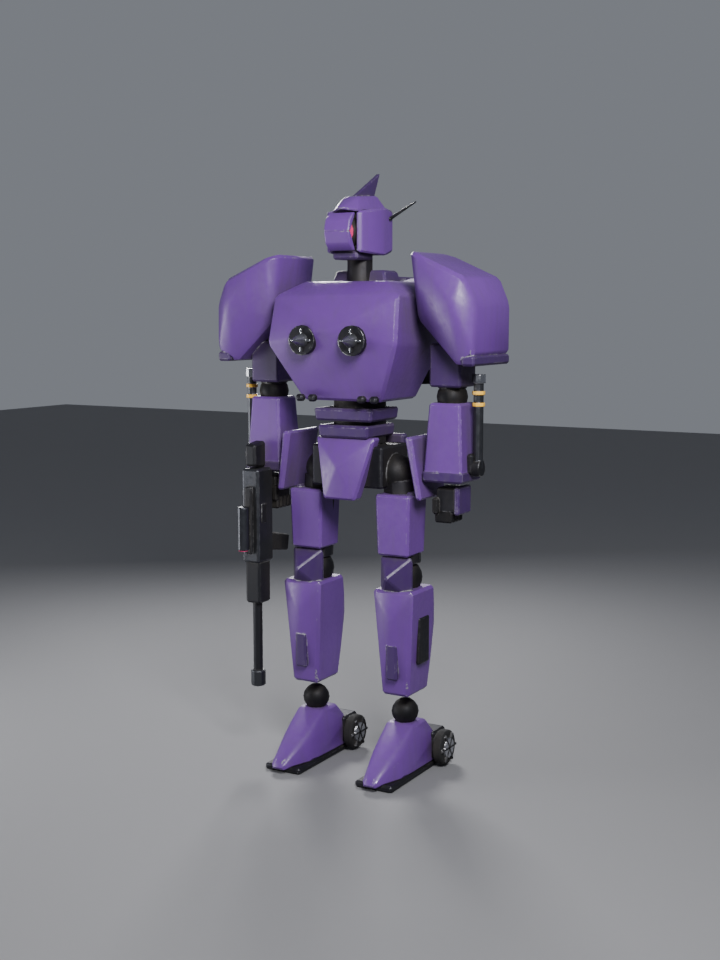
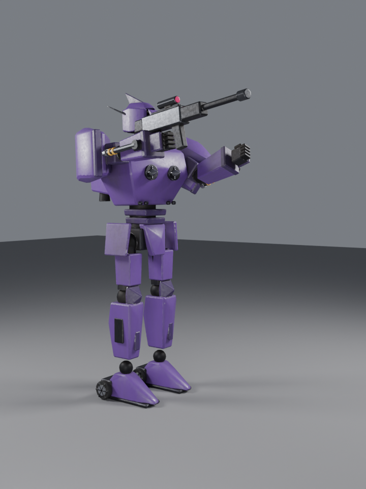
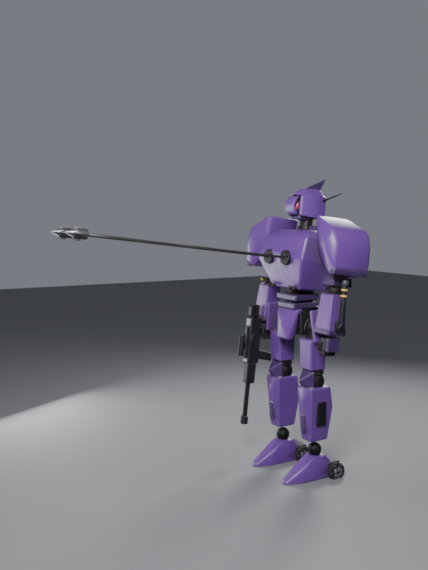
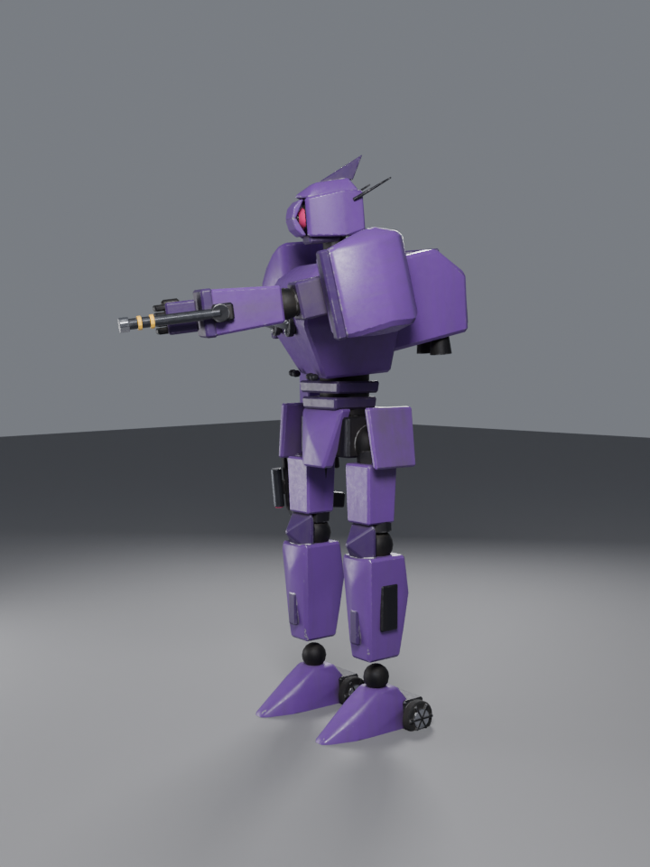
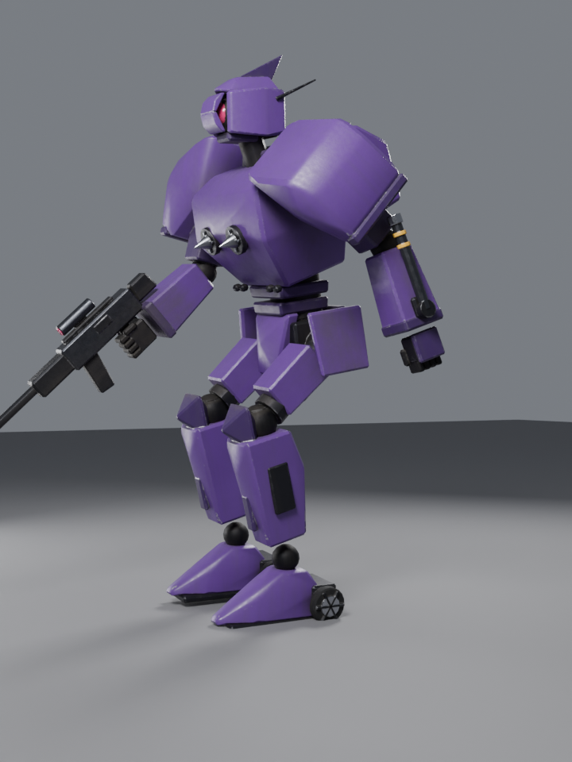
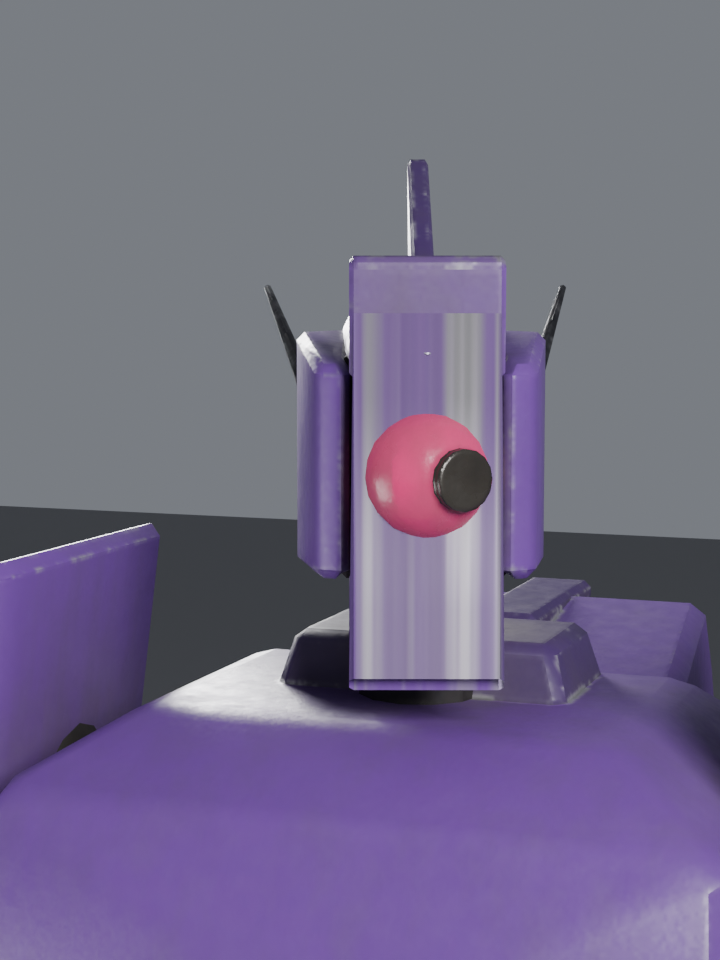
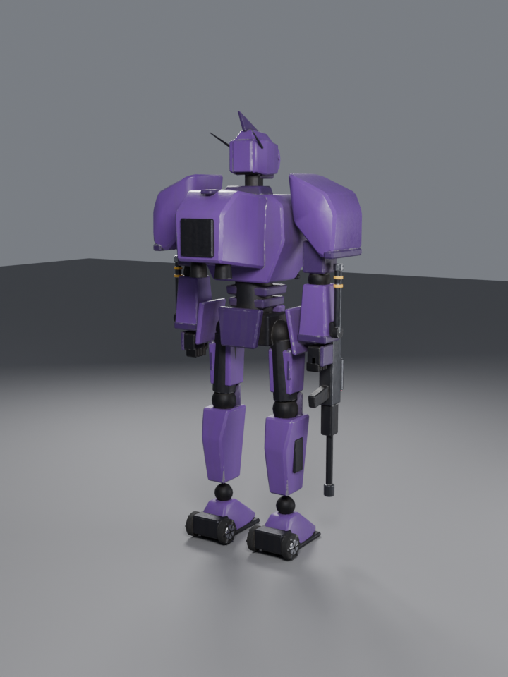

# Sutherland Knightmare Frame for Roblox

A Code Geass RPI-11 Sutherland built entirely from code with Blender's Python
API. `build_sutherland.py` models the mech, rigs it, animates it, bakes PBR
textures and exports FBX files ready for the Roblox 3D Importer.



| | | |
| --- | --- | --- |
|  |  |  |
|  |  |  |

## What's included

- **Weapons:** assault rifle (right hand, with a `Muzzle` bone for effects),
  two chest **Slash Harkens** on stretching cables, **Stun Tonfas** that flip out
  from both forearms, and the head **Factsphere** behind opening armor shutters.
- **Landspinners:** a wheel either side of each heel, on its own spinning bone,
  plus the back-mounted cockpit block.
- **Size:** 15.5 studs tall (4.4 m at 1 stud = 0.28 m). 1 Blender unit = 1 stud.
- **Meshes:** 5 skinned MeshParts, each well under Roblox's 20,000 triangle limit
  (about 10k triangles total).

  | MeshPart | Contents |
  | --- | --- |
  | `Sutherland_ArmorUpper` | chest, cockpit, head, shoulders, arms |
  | `Sutherland_ArmorLower` | skirts, legs, feet |
  | `Sutherland_Frame` | inner frame, joints, hands, Landspinners |
  | `Sutherland_Weapons` | rifle, Slash Harkens and cables, Stun Tonfas |
  | `Sutherland_Factsphere` | Factsphere lens, rifle scope lens |

- **Rig:** 30 bones with rigid (100%) skinning, at most 1 influence per vertex
  (2 on the harken cables).
  `Root > Hips > Waist > Chest > Neck > Head > Factsphere / ShutterTop / ShutterBottom`,
  `Chest > Cockpit / Harken.L/R / UpperArm.L/R > Forearm > Hand / Tonfa`,
  `Hand.R > Rifle > Muzzle`, `Hips > Thigh.L/R > Shin > Foot > Wheel`.
- **Animations** (30 fps, one FBX each in `export/anims/`):

  | Animation | Frames | Loop | Notes |
  | --- | --- | --- | --- |
  | `Idle` | 60 | yes | breathing sway |
  | `Walk` | 40 | yes | heavy stomping gait |
  | `LandspinnerDash` | 30 | yes | crouched glide, wheels spinning |
  | `RifleFire` | 50 | no | raise, 3-round burst with recoil, lower |
  | `SlashHarken` | 45 | no | both harkens fire ~11 studs out and reel back |
  | `TonfaStrikeL` / `TonfaStrikeR` | 38 | no | tonfa flips out as the punch lands |
  | `FactsphereScan` | 60 | no | shutters open, sensor sweeps, shutters close |

- **PBR textures** (`export/textures/`, 1024², Factsphere 256²): Color,
  Metalness, Roughness and Normal (OpenGL / tangent space) for each MeshPart,
  baked in Cycles from a procedural shader with paint variation, chipped edge
  wear to bare metal, crevice grime and rain streaks.

## Import into Roblox Studio

1. **Avatar tab > Import 3D**, pick `export/Sutherland.fbx`.
2. In the import settings set **File Dimensions** to **Studs**. The preview
   should read about 15.5 studs tall. Keep the rig (bones) enabled.
3. Import. You get a Model with 5 MeshParts skinned to the bones.
4. For each MeshPart add a **SurfaceAppearance** and upload its four
   textures, `Sutherland_<Part>_Color/Metalness/Normal/Roughness.png`, into
   ColorMap, MetalnessMap, NormalMap and RoughnessMap.
5. Optional: set `Sutherland_Factsphere` Material to **Neon** so the eye glows,
   and put a ParticleEmitter or PointLight on an Attachment at the `Muzzle` bone
   for muzzle flash.

### Animations

1. Add an `AnimationController` (with an `Animator`) to the model.
2. Open the **Animation Editor**, select the model, then
   **⋯ > Import > From FBX Animation** and choose a file from `export/anims/`.
3. Publish it, then play it from a script:

```lua
local animator = model.AnimationController.Animator
local anim = Instance.new("Animation")
anim.AnimationId = "rbxassetid://YOUR_ID"
animator:LoadAnimation(anim):Play()
```

Looping animations (`Idle`, `Walk`, `LandspinnerDash`) should have **Looping**
turned on in the Animation Editor before publishing.

## Rebuilding

Needs Blender 4.2+ (tested with 5.0) or the `bpy` module from pip
(Python 3.11):

```bash
pip install bpy
python3 build_sutherland.py              # ~5 min on 4 CPU cores
python3 build_sutherland.py --no-bake    # fast: geometry, rig, animations only
blender -b -P build_sutherland.py -- --res 1024 --samples 16
```

Outputs: `export/Sutherland.fbx`, `export/Sutherland.blend`,
`export/anims/*.fbx`, `export/textures/*.png` and `previews/*.png`.

The shapes, colors and animation poses are all plain data near the top of
each `build_*` function, so tweaking a part is a one-line change and a re-run.
